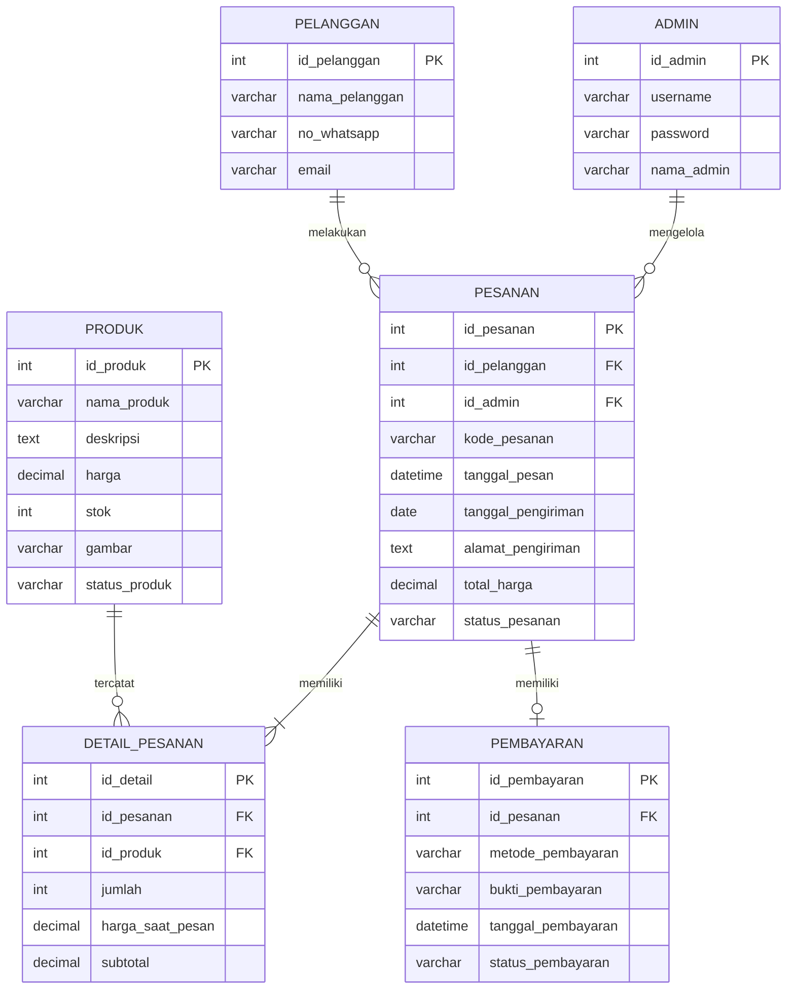

# Entity Relationship Diagram (ERD)

## 1. Pengertian

Entity Relationship Diagram (ERD) merupakan gambaran hubungan antarentitas yang digunakan dalam database. ERD pada Sistem Pemesanan Buket Berbasis Web dibuat untuk menggambarkan data yang dibutuhkan dalam proses pemesanan buket, mulai dari data produk, pelanggan, pesanan, detail pesanan, pembayaran, hingga admin.

## 2. Entitas yang Digunakan

Berikut entitas yang digunakan dalam rancangan database Sistem Pemesanan Buket Berbasis Web:

### a. Admin
Digunakan untuk menyimpan data admin yang mengelola produk dan pesanan pada website.

- id_admin (Primary Key)
- username
- password
- nama_admin

### b. Pelanggan
Digunakan untuk menyimpan informasi pelanggan ketika melakukan pemesanan tanpa harus membuat akun.

- id_pelanggan (Primary Key)
- nama_pelanggan
- no_whatsapp
- email

### c. Produk
Digunakan untuk menyimpan informasi buket yang ditampilkan pada katalog website.

- id_produk (Primary Key)
- nama_produk
- deskripsi
- harga
- stok
- gambar
- status_produk

### d. Pesanan
Digunakan untuk menyimpan informasi pemesanan yang dilakukan pelanggan, termasuk informasi pengiriman dan status pesanan.

- id_pesanan (Primary Key)
- id_pelanggan (Foreign Key)
- id_admin (Foreign Key)
- kode_pesanan
- tanggal_pesan
- tanggal_pengiriman
- alamat_pengiriman
- total_harga
- status_pesanan

### e. Detail Pesanan
Digunakan untuk menyimpan rincian produk yang dipesan dalam suatu pesanan, termasuk jumlah produk dan harga pada saat pemesanan.

- id_detail (Primary Key)
- id_pesanan (Foreign Key)
- id_produk (Foreign Key)
- jumlah
- harga_saat_pesan
- subtotal

### f. Pembayaran
Digunakan untuk menyimpan informasi pembayaran pesanan, termasuk metode pembayaran dan bukti pembayaran yang diunggah pelanggan.

- id_pembayaran (Primary Key)
- id_pesanan (Foreign Key)
- metode_pembayaran
- bukti_pembayaran
- tanggal_pembayaran
- status_pembayaran

## 3. Diagram ERD

## 4. Penjelasan Hubungan Antarentitas

1. **Admin dan Pesanan**  
   Admin dapat mengelola banyak pesanan, sedangkan setiap pesanan dapat dikelola oleh admin. Admin yang menangani pesanan dapat dicatat setelah pesanan mulai diproses.

2. **Pelanggan dan Pesanan**  
   Satu pelanggan dapat melakukan lebih dari satu pesanan, sedangkan satu pesanan hanya dimiliki oleh satu pelanggan.

3. **Pesanan dan Detail Pesanan**  
   Satu pesanan memiliki satu atau lebih detail pesanan yang berisi produk, jumlah, dan harga produk yang dipesan.

4. **Produk dan Detail Pesanan**  
   Satu produk dapat tercatat dalam banyak detail pesanan, sedangkan satu detail pesanan hanya mengacu pada satu produk.

5. **Pesanan dan Pembayaran**  
   Satu pesanan memiliki maksimal satu data pembayaran yang berisi metode pembayaran, bukti pembayaran, dan status pembayaran.

## 5. Kesesuaian ERD dengan Wireframe

Rancangan ERD ini disusun berdasarkan proses yang terdapat pada wireframe website, yaitu:

- **Halaman Beranda dan Katalog:** menggunakan data pada tabel Produk untuk menampilkan buket yang tersedia.
- **Halaman Detail Produk:** menampilkan informasi produk berdasarkan data pada tabel Produk.
- **Halaman Keranjang:** menampung pilihan produk dan jumlah produk yang akan dipesan sebelum checkout.
- **Halaman Checkout:** menyimpan data pelanggan, alamat pengiriman, tanggal pengiriman, serta informasi pesanan.
- **Halaman Pembayaran:** menyimpan metode pembayaran dan bukti pembayaran pada tabel Pembayaran.
- **Halaman Konfirmasi Pesanan:** menampilkan informasi pesanan yang tersimpan pada tabel Pesanan dan Detail Pesanan.
- **Halaman Pelacakan Pesanan:** menggunakan kode pesanan dan nomor WhatsApp untuk membantu pelanggan melihat status pesanan.

## 6. Kesimpulan

ERD ini merupakan rancangan awal database yang digunakan untuk mendukung Sistem Pemesanan Buket Berbasis Web. Rancangan terdiri dari enam entitas utama yang saling berhubungan untuk mendukung pengelolaan produk, pemesanan tanpa akun pelanggan, pembayaran, dan pelacakan pesanan. Rancangan ini akan menjadi dasar dalam pembuatan database menggunakan MySQL atau MariaDB pada tahap implementasi.
